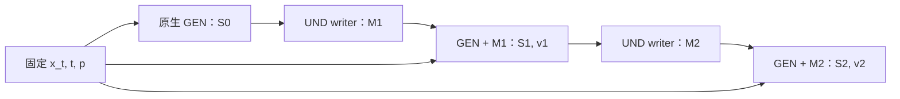

# 推理结构

本文对应 `loop-layer-NPU` 分支的连续Memory推理实现。主流程是：冻结GEN读取当前带噪状态，连续UND writer将逐层GEN K/V写入16槽Memory，随后由UND读出caption，或由GEN消费Memory并继续采样。推理不更新参数。

方法与训练目标见[设计](design.md)，checkpoint及人工结果见[实验](experiments.md#12-c2-observe及固定来源对照)。本文说明实际调用流程，不把实现完成等同于语义或画质收益。

## 1. 实现范围

|路径|当前作用|
|---|---|
|`source-review`|固定状态，比较正确、关闭、交换来源的Memory caption；不向GEN注入Memory|
|`eval`|固定状态，执行R1/R2及GEN消费对照；可导出局部预测或单节点注入后的续采样|
|`sample`|从纯噪声开始，分别运行Base、R1、R2完整轨迹|
|文本Memory对照|文本先经BAGEL原生prefill，再由C1 writer压缩；使用旧文本实验入口|

当前视觉循环每轮完整重算GEN，writer连续经过全部28个UND层。原training-free的 `legacy_layerwise`、`full_depth`、`full_depth_restart` 和 joint-micro保留在 [`older-2`](https://github.com/zyd-ustc/bagel-LatentCoT/tree/older-2) 分支，入口为该分支的 `qwen_latent_cot/bagel/internal_loop.py`。它们与本文的完整GEN反馈循环是不同实现。

## 2. 输入与状态

|符号|含义|
|---|---|
|`p`|实际进入BAGEL文本prefill的prompt|
|`t`|实际flow时间；1为纯噪声，0为干净端|
|`x_t`|当前带噪图像latent|
|`S_r`|第r轮GEN当前query序列的逐层K/V；包含层号、t、轮次、token角色和位置|
|`M_r`|第r轮writer导出的逐层16槽Memory K/V|
|`v_r`|第r轮完整GEN输出的conditional速度；尚未经过CFG|

配对状态先将图片固定缩放为512×512，经冻结VAE得到 `x_0`，再构造 `x_t=(1-t)x_0+tε`。噪声由 `noise_seed`控制，VAE采样种子绑定图片内容哈希。

完整采样从 `t=1` 的 `ε`开始。当前入口仍要求图像数据行，初始化代码会编码图片，但初始 `x_t`直接取纯噪声；原图和配对caption不作为生成条件。

默认 `source_prompt_policy=neutral`，因此 `p="An image."`，数据行的目标caption只用于监督或参考。此默认配置是研究用中性prompt协议。使用部署prompt须同时设置 `source_prompt_policy=deployment`、`allow_target_prompt=true`，并使用接口策略匹配的checkpoint；现有中性协议checkpoint不能靠临时改配置绕过严格检查。

prompt通过BAGEL原生 `prepare_prompts` 和 `forward_cache_update_text`构造逐层cache。每次GEN调用保留这份prompt K/V；Memory不全替换prompt，也不写入持久prompt cache。

## 3. GEN来源写入Memory

### 3.1 捕获来源

`conditional_gen()`沿用原生 `_forward_flow` 的输入、MoT专家、归一化、位置与输出头，设置CFG scale为1，捕获conditional分支的逐层K/V。

默认 `visual_source_policy=full_query`：读取本轮图像token及边界token，不直接复制历史prompt K/V。图像token使用原生GEN专家投影，边界token保留原生文本投影；K使用原生K norm与RoPE。来源已旋转，writer不重新旋转它。`image_only`可只保留图像token，属于需要匹配checkpoint的另一接口策略。

捕获点位于各层attention输入。来源不是单个最终hidden，也不是VAE解码图片。GEN状态本身仍受prompt及前面各层计算影响。

### 3.2 中性初始化与连续更新

固定 `neutral_text`取前16个非特殊token。原生UND中性prefill保存逐层输入种子；连续writer每轮从第0层种子，即这16个token的冻结embedding开始。初始化不含样本caption。

同一份Memory hidden依次经过28个UND层。第l层读取同层GEN来源K/V和Memory自身K/V，执行冻结UND完整block，然后应用已有C1低秩残差；更新后的hidden进入下一层。writer内部attention为非因果读取，caption解码另用因果attention。

视觉适配器只作用于UND query。设 `z`为当前Memory的归一化hidden，原生query投影为 `W_Q`，则：

```text
q_raw = W_Q(z) + U_l(D_l(z) + T_l(phi(t)))
q     = RoPE(q_norm(q_raw))
```

`phi(t)`是8维固定正余弦特征，新增视觉低秩为32。推理使用checkpoint权重；来源GEN K/V、原生UND/GEN参数均保留。视觉适配关闭时使用原C1 writer；关闭来源时UND不接收外部GEN K/V，但仍执行Memory自身更新及视觉query适配。

每层更新后，writer用同层UND input norm、K/V投影及K norm导出Memory K/V。导出bank覆盖全部28层，K尚未施加消费位置的RoPE。16槽不是caption token的一一对应表示。

### 3.3 生命周期与位置

|阶段|位置及状态|
|---|---|
|writer内部更新|Memory位置2048–2063；来源保留捕获时的原生位置|
|bank导出|逐层K/V；K未旋转|
|UND caption读出|Memory占0–15；固定指令及生成文本从16开始|
|GEN消费|原prompt之后放16槽Memory；本轮GEN query位置后移16|

消费时只对Memory K施加一次消费位置RoPE，V不旋转。来源位置必须低于2048，不能与writer内部槽位重叠。

每轮writer重新使用同一中性种子，不把上一轮末层Memory hidden送回首层。每个采样时间步也重新初始化Memory。轮间信息通过更新后的GEN来源 `S_r`反馈，跨时间步的变化通过采样latent传递。

## 4. 三条消费路径

### 4.1 Caption来源对照

本图原生GEN提供 `S_0`，随后构造三组bank：

|组别|writer来源|
|---|---|
|Correct|本图的 `S_0`|
|Source-off|不读取外部GEN K/V|
|Source-swap|交换图在相同t、噪声种子和prompt下的 `S_0`|

冻结UND只读取Memory、固定描述指令和已生成的文本，自由输出caption；当前最多48 tokens、贪心解码。参考caption用于单独的teacher-forcing NLL计算，不进入自由读出的答案前缀。

审查页的预测预览为 `VAE.decode(x_t-t·v_0)`，其中 `v_0`来自无Memory的原生conditional GEN。它是当前状态的观察代理，不是GEN基于Memory生成的图像。A/B/C按状态随机映射到三组，点击“揭示组别”查看。

### 4.2 R1/R2同状态反馈

箭头表示信息依赖；各次GEN调用的 `x_t,t,p`始终相同：



R1运行到 `v_1`，共2次conditional GEN；R2运行到 `v_2`，共3次conditional GEN。循环内不更新latent、不推进采样器，不执行CFG。R2的 `S_1`是注入M1后捕获的来源，位置也记录了16槽平移。最终出口默认只返回速度，开启diagnostics时也捕获其K/V；图中的S表示GEN内部状态，不表示每次调用都保存全部来源。

R2支持四种反馈：

|反馈|第二轮做什么|
|---|---|
|`new`|从相同中性种子读取 `S_1`，构造新的M2|
|`old`|从相同种子再次读取旧 `S_0`，重新构造bank|
|`fixed`|直接复用M1，再调用一次GEN|
|`swap`|读取交换图的更新后GEN来源，要求实际prompt和t相同|

`old`与`fixed`分别控制重复旧来源和固定Memory。`source-review`交换的是单轮写入来源；R2-swap交换的是第二轮反馈来源，两者不能混称为同一对照。

### 4.3 GEN注意力消费

`gen_memory_call()`临时接入一次conditional调用。各层注意力读取：

```text
K_all = [原prompt K, 同层Memory K, 本轮GEN自身K]
V_all = [原prompt V, 同层Memory V, 本轮GEN自身V]
```

GEN query及自身K/V继续使用原生专家投影、Q/K norm和输出投影。Memory只扩展可见条件序列；不替换GEN hidden，不把UND输出直接作为GEN residual，也不改DiT参数。

Memory仅接入匹配的conditional cache。CFG无条件分支继续走原生路径。调用结束后恢复decoder和attention入口，Memory K/V不持久化。`G-layout`保留16位置平移但屏蔽Memory，是布局对照。

`eval`中的其他对照名称如下：

|组别|GEN条件或来源|
|---|---|
|R0|无Memory的原生GEN|
|G-fixed / G-neutral|零K/V bank / 中性种子bank|
|C1-direct-GEN|原C1 writer读取GEN来源，关闭新增视觉query适配|
|Source-off / Source-swap|本图关闭来源的bank / 交换图单轮写入的bank|
|Fixed-source|本rank首次捕获的固定GEN来源；来源元数据保留|
|Target-C1-oracle|冻结文本教师读取目标caption生成的bank|
|Target-text-oracle|目标caption追加到原生文本条件，不使用视觉Memory|

Oracle组显式读取目标caption，只作参考。各臂记录的caption来自UND读取该臂的bank，不是GEN对输出图像的描述；R0的caption使用中性bank占位，不能据此评判原生GEN是否识别图像。

## 5. 完整采样

默认配置生成50个时间节点，因此执行49次Euler更新。均匀节点u经shift=3变换：`t=3u/(1+2u)`，从1走向0。

每个启用Memory的节点按顺序执行：

1. 固定当前latent、t和prompt，运行R1或R2。
2. 取最终bank，重新执行原生conditional GEN及CFG；此额外重算真实发生，不直接复用循环出口速度。
3. 使用CFG及原生重归一化后的速度，只做一次更新：`x_next=x_t-(t-t_next)·v_CFG`。
4. 在下一节点重新从中性种子写入Memory。

默认CFG text scale=4、image scale=1、global重归一化。完整采样前20次更新启用Memory，后29次更新使用原生GEN。当前第19号节点约为t=0.825688，更新到第20号节点t=0.813084后退出Memory窗口；这个窗口是高噪声端的前20次更新，并非“t<0.75”。这里仅记录现有配置，没有更改窗口。

离开窗口后不再注入Memory，但此前对latent轨迹的影响仍保留。Base、R1、R2各自从相同种子的纯噪声独立采样，不能拿某条轨迹的中间状态代替另一条轨迹。

|策略|活跃节点GEN调用数|默认整条轨迹GEN调用数|
|---|---:|---:|
|Base|2：conditional + CFG分支|98|
|R1|4：循环2次 + conditional/CFG重算2次|138|
|R2|5：循环3次 + conditional/CFG重算2次|158|

以上是当前默认配置的GEN调用数，不是FLOPs或等算力比较；不包含UND writer和caption读出。真实记录保存在每张图的节点JSON中。

## 6. 入口、命令与输出

在modelarts-job的 `/root/bagel-LatentCoT-loop-layer-NPU`执行。需要原生BAGEL模型、C0校准记录、独立冻结1100步文本教师和格式2视觉checkpoint。启动器默认16卡；输出目录须尚不存在。`VISUAL_PARENT`用于加载推理checkpoint，推理不使用优化器恢复。

以下命令是使用已有C2-observe最佳checkpoint的可执行示例，不表示这些GEN评测已执行或获得质量结论：

```bash
cd /root/bagel-LatentCoT-loop-layer-NPU
export VISUAL_DATA=/data/zyd_workspace/bagel-LatentCoT/datasets/visual_source_review4_20261013.jsonl
export VISUAL_PARENT=/root/outputs/visual_observe_full_20261012/best.pt

# 只审查Memory caption；12个状态、三组来源。
bash scripts/visual_training_npu.sh source-review \
  /root/outputs/source_caption_review_new \
  --split val --review-t 0.25 0.75 0.9 --noise-seeds 0

/root/venvs/bagel-NPU/bin/python scripts/render_source_review.py \
  /root/outputs/source_caption_review_new

# 同状态R1/R2 GEN消费对照，保存局部x0预测图。
bash scripts/visual_training_npu.sh eval \
  /root/outputs/source_gen_eval_new \
  --split val --rounds 2 --eval-t 0.25 0.75 0.9 1.0 \
  --noise-seeds 0 --images

# 三条独立完整轨迹：Base、R1、R2。
VISUAL_STAGE_CONFIG=visual_memory_pilot \
  bash scripts/visual_training_npu.sh sample \
  /root/outputs/source_full_sample_new --split val --noise-seeds 0
```

`eval`的配置校验要求保留t=1，须按纯噪声对照单独解读。`source-review`使用独立 `--review-t`，不改变此配置规则。完整 `sample`入口固定运行Base/R1/R2三条轨迹，不通过 `--rounds`筛选其中一条。

`eval --images`默认导出 `x_t-t·v_CFG`的局部预测。加 `--continue-sampling`后，配对状态会先重建到最近的原生时间节点，再在该节点注入Memory、沿原生后缀采样；记录同时保存请求t和实际t。此模式只在选定节点注入，不等同于完整采样窗口策略。`--layer-diagnostics`另存只读逐层张量。

|入口|主要输出|调度|
|---|---|---|
|source-review|`source_review.json`、各rank的caption/图片、`index.html`、盲审映射及标注文件|按图像×t×seed状态分配|
|eval|各rank的 `metrics_by_t_round.jsonl`、`summary.json`，可选盲评图及逐层张量|按family分配|
|sample|各rank的Base/R1/R2图片及逐节点JSON|按family分配|
|全部|`manifest.json`、实际配置、锁定数据、来源diff及文件/checkpoint哈希|rank 0汇总运行元数据|

`eval`没有自动跨rank合并全部指标，不能把某个rank的summary当作全体结果。source-review会汇总所选状态的三组caption；上述4图示例共36条，由renderer生成统一审查页。

## 7. 代码索引与当前证据

|实现|位置|
|---|---|
|入口、16卡调度|[visual_cli.py](../qwen_latent_cot/diagnostics/visual_cli.py)、[visual_training_npu.sh](../scripts/visual_training_npu.sh)|
|状态、prompt prefill、CFG|[runtime.py](../qwen_latent_cot/diagnostics/runtime.py)|
|连续UND writer及消费位置|[memory.py](../qwen_latent_cot/diagnostics/memory.py)|
|视觉query残差|[visual.py](../qwen_latent_cot/diagnostics/visual.py)|
|GEN来源捕获、临时Memory注入|[native.py](../qwen_latent_cot/diagnostics/native.py)|
|完整conditional GEN|[flow_training.py](../qwen_latent_cot/diagnostics/flow_training.py)|
|同状态R1/R2|[loop_training.py](../qwen_latent_cot/diagnostics/loop_training.py)|
|GEN对照、完整采样|[visual_evaluation.py](../qwen_latent_cot/diagnostics/visual_evaluation.py)、[schedule.py](../qwen_latent_cot/diagnostics/schedule.py)|
|caption来源审查|[source_review.py](../qwen_latent_cot/diagnostics/source_review.py)、[render_source_review.py](../scripts/render_source_review.py)|
|严格checkpoint加载|[visual_record.py](../qwen_latent_cot/diagnostics/visual_record.py)|

当前已有Ascend E0工程检查、C2-observe 1000步训练及4图caption来源对照。完整GEN联合训练、R2语义收益和完整采样质量不能由caption读出或工程检查代替；实际执行状态与人工观察以[实验记录](experiments.md#12-c2-observe及固定来源对照)为准。
