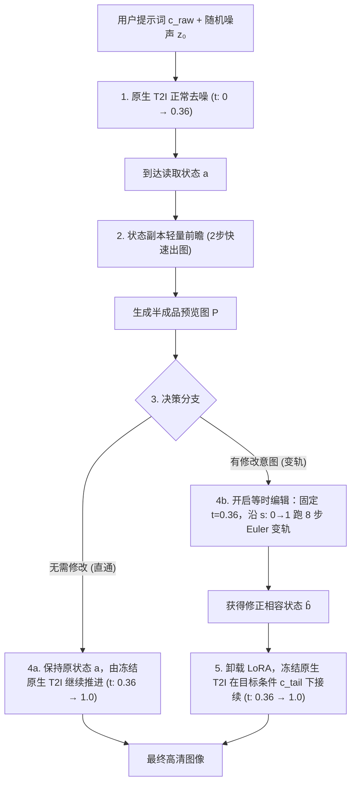

# 等时状态流推理 (Inference)

本文档介绍等时状态流（Isochronic State Flow）的推理流程、调用模式、运行命令与开销核算。

---

## 1. 推理全流程（通俗直观）

整个推理过程分为 **原生前缀 $\to$ 中途轻量前瞻 $\to$ 决策分流 $\to$ 原地变轨 $\to$ 原生接续** 五个阶段：



### 关键步骤分解：
1. **时间冻结与前瞻**：到达部署读取点 $t=0.36$ 后，生成时间 $t$ 暂停。通过 2 步轻量前瞻生成半成品预览图 $P$。
2. **场景感知**：多模态理解模块（UND）看着预览图 $P$ 和原提示词，确认画面现状，明确“改哪里、保留什么”。
3. **8 步等时变轨**：在固定 $t=0.36$ 下，沿编辑进度轴 $s \in [0, 1]$ 运行 8 步 Euler 积分：
   
   $$q_0 = a, \quad q_{m+1} = q_m + \frac{1}{8} u_\theta\left(q_m, t, \frac{m}{8}\right), \quad \hat{b} = q_8$$

4. **原生高画质渲染**：变轨完成后卸下 LoRA，将状态 $\hat{b}$ 交还给完全未修改的原生 T2I 模型，在目标条件 $c_{\text{tail}}$ 下沿 $t \to 1$ 接续成图，完美保留底座的高清纹理与先验。

---

## 2. 两种推理模式

### 模式 1：闭环文生图自纠偏 (Closed-Loop Self-Correction)
系统自主检测并修复生成缺陷，无需人工介入：
- **输入**：仅需原始文生图提示词 `c_raw`。
- **机制**：诊断器结合预览图 $P$ 与提示词自主判断：
  - 若结构正确 $\to$ 走直通路线（`native_passthrough`），不消耗状态编辑算力。
  - 若存在缺陷（如数量不足、主体遗漏） $\to$ 自主提炼修正指令 $e$（目标条件 $c_{\text{tail}} = c_{\text{raw}}$），原地变轨纠偏。

### 模式 2：显式用户交互编辑 (Explicit User Editing)
中途响应用户的精准编辑意图：
- **输入**：原提示词、修改指令 `edit_instruction`、目标场景描述 `tail_condition` 以及保留约束 `preserve`。
- **机制**：跳过自动诊断，直接将多模态语义条件注入 joint prefix 前缀，在 $t=0.36$ 状态上精准定向变轨。

---

## 3. 推理命令

### 3.1 等时变轨采样 (Sample)
```bash
u15-target-correction sample \
  --model "$MODEL_DIR" \
  --source "$SOURCE_DIR" \
  --config configs/u15_isochronic_state/sample36.json \
  --checkpoint "$CHECKPOINT_DIR/step_001000" \
  --prompts "$PROMPTS_FILE" \
  --output "$OUT_DIR/samples" \
  --device npu:0
```
- 提示词文件 `$PROMPTS_FILE` 可以是简单的文本行，也可以是带有 `edit_instruction`、`tail_condition` 等字段的 JSONL 文件。

### 3.2 显式原生基线对比 (Native Baseline)
直接调用冻结的原生 SenseNova-U1.5 模型（不加载任何 LoRA 或状态编辑模块），用于对比测试：
```bash
# 原生纯文生图对照 (T2I)
u15-target-correction native \
  --model "$MODEL_DIR" --source "$SOURCE_DIR" \
  --config configs/u15_isochronic_state/sample36.json \
  --mode t2i --prompts "$PROMPTS_FILE" \
  --output "$OUT_DIR/baseline_t2i" --device npu:0

# 原生图生图对照 (IT2I)
u15-target-correction native \
  --model "$MODEL_DIR" --source "$SOURCE_DIR" \
  --config configs/u15_isochronic_state/sample36.json \
  --mode it2i --prompts "$PROMPTS_WITH_SRC_IMG" \
  --output "$OUT_DIR/baseline_it2i" --device npu:0
```

---

## 4. 计算账目与性能核算

推理运行记录中，单条样本均会输出细粒度的调用账目（`calls`）：

| 环节 | 含义与前向次数 | 说明 |
|---|---|---|
| `parent_trajectory` | 原生前向 $t: 0 \to 0.36$ | 原生 T2I 的前半程去噪求值 |
| `preview` | 状态副本前瞻 2 步 | 生成半成品草图 $P$ |
| `prefill` | 2 次多模态 UND 前向 | 分别为图像分支与多模态联合前缀的 KV 计算 |
| `baseline` | 1 次冻结图像分支 | 计算锚点基准 $b_0$ |
| `state_edit` | **8 次** joint 状态场求值 | 等时编辑核心：8 步 Euler 变轨推进 |
| `tail` | 原生接续 $t: 0.36 \to 1.0$ | 卸载 LoRA 后，原生 T2I CFG 的尾段渲染求值 |

**直通（Passthrough）收益**：对于无需修改的正常样本，`state_edit`、`prefill` 与额外的尾段重算全部归零，仅付出极轻量的前瞻诊断代价，无缝回归原生极速生成。
