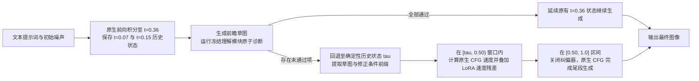

# 目标驱动纠偏推理指南

本文档介绍训练后模型的推理流程与运行方法。系统接口定义与数据协议见 [目标驱动纠偏实现规范](target_correction.md)。

## 推理流程

文生图推理完全由纯文本提示词与随机种子驱动，不需要外部输入源图。



### 关键推理机制

1. **零噪声刷新回退**
   当诊断发现错误时，系统根据缺陷类型选择深回退时间 0.07 或浅回退时间 0.15。回退过程使用 `rho = 0.0`，直接恢复历史保存的状态，不添加任何独立高斯噪声。

2. **线性退场加权**
   速度残差在纠偏窗口内按线性权重递减：
   $$w(t) = \operatorname{clip}\left(\frac{0.50 - t}{0.50 - \tau}, 0, 1\right)$$
   在时间达到 0.50 时权重归零，纠偏器完全退出，由原生模型在原始提示词条件下独立完成剩余尾段。

3. **双分支提案引导**
   纠偏器在每个求解步读取原生生成器当前的无梯度干净预测，结合冻结理解模块的草图特征共同计算速度修正量。

## 运行采样命令

使用训练完成的 Stage 2 检查点运行文生图推理：

```bash
python -m qwen_latent_cot.u15_target_correction.cli sample \
  --model "$MODEL" --source "$SOURCE" \
  --config configs/u15_proposal_correction/target_stage2.json \
  --checkpoint "$STAGE2_CHECKPOINT" --ema \
  --prompts "$PROMPTS" --output "$OUT" \
  --device npu:0 --compare-native
```

参数说明：
- `--checkpoint`：Stage 2 检查点目录路径。
- `--ema`：载入指数移动平均权重进行生成。
- `--prompts`：包含待测试提示词的 JSONL 文件。每行提供 `raw_prompt`（或 `prompt`）以及可选的 `uid` 和预设诊断问题。
- `--compare-native`：同时保存同种子的原生生成图像，用于对比基准。
