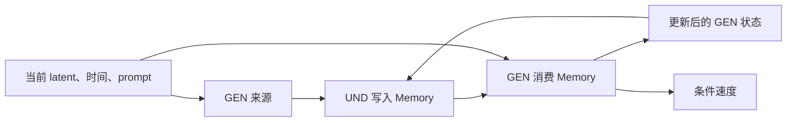

# 推理原理

推理将“读取生成状态、写入Memory、消费Memory”组成反馈循环。UND负责把来源信息组织成语义条件，GEN负责将这些条件融入图像生成。

## 1. 状态与信息角色

|对象|作用|
|---|---|
|Prompt，记为p|提供原生文本条件|
|带噪latent，记为x_t|表示当前生成状态|
|噪声时间，记为t|描述当前噪声水平|
|GEN逐层K/V|提供Memory读取的来源|
|Memory逐层K/V|为理解与生成提供独立语义条件|
|生成速度|决定latent如何向下一个时间状态演化|

文本预填充构造原生prompt条件。GEN在此条件下处理当前latent，将图像与文本的影响组织到各层状态中。Memory从这些状态读取信息，形成新的条件表达。

## 2. 同层来源与连续写入

来源来自本轮GEN query序列。图像token和边界token沿用各自的原生专家投影，K/V携带同层归一化和位置信息。

UND的Memory query逐层读取这些K/V。每层先融合来源和Memory自身状态，再通过UND变换与低秩残差更新hidden。更新后的Memory进入下一层，同时导出该层的语义K/V。

噪声时间影响GEN来源的表示，也参与视觉query适配。Memory因此可以在不同生成阶段采用不同的读取方式。

## 3. 内容与位置的组织

来源K保留GEN计算时的旋转位置编码RoPE。Memory在writer中使用独立的位置表达，导出后由消费者赋予相应的序列位置。

UND文本读出把Memory放在固定描述指令之前。GEN消费将Memory放在原prompt条件与当前图像query之间。两侧通过同层K/V读取同一Memory表达，各自保留原生的位置与注意力结构。

## 4. 两种Memory消费

### 文本读出

冻结UND以Memory、固定描述指令和已生成文本为上下文，逐词生成caption。记Memory为M、指令为I、此前生成文本为y的因果前缀：

$$
P(y_j\mid M,I,y_{<j}).
$$

这种读出将Memory中的信息转成可阅读的语言。正确来源、关闭来源和交换来源的对照，分别使用本图来源、Memory自身更新和另一图来源，读出文字呈现各类输入下的语义表达。

原生预测预览使用来源提取阶段的GEN速度，估计干净latent，再经VAE解码。记该速度为v_native，干净latent估计为x̂_0：

$$
\hat{x}_0=x_t-t\,v_{\mathrm{native}}.
$$

它展示当前生成状态的图像预测。Caption展示UND对Memory的语义读出，两者对应不同的信息通路。

### 生成消费

GEN query同时读取原prompt、Memory和本轮图像自身的K/V：

$$
K_{\mathrm{all}}=[K_{\mathrm{prompt}};K_{\mathrm{Memory}};K_{\mathrm{image}}],
$$

$$
V_{\mathrm{all}}=[V_{\mathrm{prompt}};V_{\mathrm{Memory}};V_{\mathrm{image}}].
$$

Memory通过注意力参与条件融合。原生GEN继续执行专家投影、归一化、后续层变换和速度输出。Memory的语义作用由整个生成网络传播到最终速度。

## 5. 同一时间状态内的反馈

一个采样时间状态内，latent、噪声时间和prompt保持固定。先运行原生GEN获得来源，再交替执行Memory写入和GEN消费：

设 `S^{(r)}`为第r轮GEN来源，`M^{(r)}`为Memory，`H_{\mathrm{neutral}}`为中性起点：

$$
M^{(r)}=\operatorname{Writer}(H_{\mathrm{neutral}},S^{(r-1)},t),
$$

$$
(S^{(r)},v^{(r)})=\operatorname{GEN}(x_t,t,p;M^{(r)}).
$$

每轮Memory重新从中性起点构造，更新后的GEN来源携带前一轮条件消费的影响。信息沿“GEN状态→Memory→GEN状态”循环传递。

来源对照可以读取新反馈、重复旧反馈、复用已有Memory或读取另一图的反馈。它们分别呈现新增来源信息、重复读取、重复消费和来源交换的作用。

## 6. 反馈循环与采样演化

同状态反馈和采样推进构成两层循环。内层在固定状态上组织和消费信息，外层根据最终速度推进latent。

最终Memory进入条件分支。原生无条件分支参与无分类器引导CFG（Classifier-Free Guidance），引导与归一化形成实际采样速度。

从当前时间t走向下一时间s时，Euler更新为：

$$
x_s=x_t-(t-s)v_{\mathrm{CFG}}.
$$

新的时间状态重新构造Memory。Memory对前一状态的影响通过更新后的latent继续传递，prompt条件在采样过程中持续保留。

反馈窗口决定采样过程中的哪些阶段采用Memory读写。窗口中的状态通过反馈组织生成条件，窗口后的状态沿原生生成过程继续演化。

## 7. 三种观察方式

|观察方式|呈现的信息|
|---|---|
|Memory caption|UND从Memory恢复的语义|
|固定状态的图像预测|当前速度对应的图像估计|
|完整采样图像|反馈、引导及连续latent更新共同形成的结果|

局部预测将当前速度映射为图像，续采样将选定状态接入后续生成过程，完整采样则展示整条反馈轨迹的最终结果。

设计动机与训练思想见[设计](design.md)，实际实验设置与结果见[实验记录](experiments.md)。
