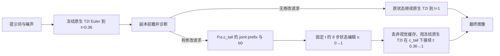

# 等时状态流推理

实现合同见 [等时生成态编辑](target_correction.md)。



读取点固定为 `t=0.36`，不再按失败类型回退到 0.07 或 0.15。编辑期间 `t` 不变；不刷新噪声，不在编辑内推进 `t`，不在转换后叠加文本速度差。

## 闭环文生图

```bash
u15-target-correction sample \
  --model "$MODEL" --source "$SOURCE" \
  --config configs/u15_isochronic_state/sample.json \
  --checkpoint "$CHECKPOINT" \
  --prompts "$PROMPTS" --output "$OUT" --device npu:0
```

诊断器只核对原提示要求。无修改请求时走 `native_passthrough`，不运行状态算子。有修改请求时 `c_parent=c_tail=c_raw`，执行：

```text
q0 = a
q_{m+1} = q_m + uθ(q_m, r, m/8) / 8,  m=0..7
b_hat = q8
x = NativeT2I(c_tail) from r to 1
```

单次只返回一个结果，不做生成后选优。

## 显式用户编辑

提示词行可以带 `edit_instruction`、`tail_condition` 和 `preserve`。此时跳过诊断，`c_tail` 使用完整目标场景描述；UND joint prefix 与尾段原生 T2I 使用同一字符串。预览仍由父条件 `c_raw` 在读取状态副本上生成。本模式需要相应的 I/R 训练记录覆盖，不能仅用自纠错训练宣称任意交互编辑已验证。

## 记录和成本

每行 JSON 记录 `route`、诊断问题、`edit_request`、`c_tail`、`preserve` 和独立调用数：

```text
text_prefix, parent_trajectory, preview,
prefill, baseline, state_edit, tail_prefix, tail
```

`prefill` 是两次 UND prefill 的账本，不是一次完整前向；`baseline` 是冻结 image clean 的 1 次分支；`state_edit` 是 8 次 joint 状态场；`tail` 是原生 T2I CFG 的速度求值数。程序记录实际插入节点，不用固定倍速替代实测。

## 显式原生基线

```bash
u15-target-correction native \
  --model "$MODEL" --source "$SOURCE" \
  --config configs/u15_isochronic_state/sample.json \
  --mode t2i --prompts "$PROMPTS" --output "$OUT" --device npu:0
```

`--mode it2i` 时提示词行还需要 `source_image`。该入口直接调用冻结的原生 `t2i_generate`/`it2i_generate`，不加载 LoRA，用于原始基线对照。
