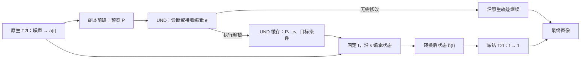

# 等时状态流：利用统一多模态模型编辑生成中的图像

> 当前进度与下一轮决定见[进度记录](isochronic_progress.md)（2026-11-08）。本文保留方案或对应轮次的记录。

## Isochronic State Flow for Editing Images During Generation

论文工作稿与下一轮训练实施方案 · 2026-11-07  
方法标识：`u15_isochronic_state_flow_v1`；当前公共计算协议：`u15_isochronic_state_flow_v2`。

## 摘要

生成模型在中途已经形成了场景布局和对象表征。此时收到新的编辑要求，系统需要改变图像语义，同时复用已有生成状态。我们提出等时状态流（Isochronic State Flow），将生成时间与编辑进度分离：固定原生生成时间，通过一条短编辑流把当前状态转换为目标条件下可继续生成的状态，再交给冻结的原生文生图模型完成图像。统一多模态模型的理解专家读取中途预览和编辑要求，生成专家通过低秩适配学习状态转换。训练采用配对状态上的条件流匹配，语义监督来自高质量编辑对，真实轨迹适配采用前向历史态与目标反演态组成的配对。

目前已完成线性配对状态上的第一阶段训练，共 3607 次更新。首、末 100 步平均损失分别为 0.14857 和 0.06441。32 例线性状态评测中，部分学生状态能够经冻结原生模型接续出清晰图像，同时出现结构修改不完整及配对几何错位。真实文生图轨迹上的编辑结果出现碎纹、颗粒和形体变形。本文据此将下一阶段的训练重点确定为真实入口、可接续出口和保持映射的联合学习，并给出数据生产、训练配方与成图评价的具体安排。

## 1. 引言：把语义编辑移到生成状态上

图像生成中的语义反馈通常晚于初始采样。主体数量、空间关系和属性需要在图像形成后才能判断，而完整生成后再编辑会重复执行部分生成工作。生成中途的状态已经包含场景信息，也保留了继续形成图像的自由度。我们的目标是在这一状态上执行语义修改。

直接替换文本条件要求原生生成场同时承担两项工作：改变已经形成的结构，并继续完成去噪。标准生成训练则主要学习如何从目标图像的加噪状态恢复目标。历史状态包含旧条件下的具体生成选择，因此，改变条件后的状态相容性成为中途编辑的核心问题。

本文将这两项工作分开。原生生成时间 `t` 描述噪声到图像的过程；编辑进度 `s` 描述同一生成时刻上的语义转换。编辑器沿 `s` 改变状态，原生模型沿 `t` 完成图像。这样，编辑器直接学习“应该转移到哪个状态”，原生生成器继续使用预训练的渲染能力。

统一多模态模型（UMM）为这一转换提供了现成的语义和空间接口。理解专家（UND）读取预览图、编辑指令和目标描述，将表征存入逐层键值缓存；生成专家（GEN）读取当前带噪状态，通过原生跨专家注意力预测编辑方向。我们保留原有位置编码、图像编码器和输出头，只训练 GEN 的低秩适配参数及编辑进度嵌入。

本文围绕三项设计展开：

1. **固定生成时间的状态输运。** 在生成过程中插入独立编辑流，将语义修改与原生去噪分开。
2. **UND 引导的状态转换。** 通过 UMM 原生视觉—语言缓存，把预览中的具体场景与本轮编辑要求传给 GEN。
3. **以接续相容性组织训练。** 用编辑对学习语义变化，再用原生轨迹上的输入状态与可重建目标的输出状态训练实际接续能力。

## 2. 相关工作与方法定位

**条件流匹配。** Flow Matching 通过回归给定概率路径的速度来训练连续流，省去训练时的完整轨迹展开。本文采用配对状态间的直线路径，将其用于固定生成时刻的状态转换。[Flow Matching for Generative Modeling](https://arxiv.org/abs/2210.02747)

**直接编辑流。** FlowEdit 利用预训练文生图流模型构造源分布到目标分布的编辑 ODE，在推理中完成图像编辑。本文学习一个由预览和指令控制的状态算子，作用对象是生成中的状态，输出继续交给原生生成过程。[FlowEdit](https://arxiv.org/abs/2412.08629)

**有信息起点的桥接。** I²SB 从含有结构信息的输入学习到目标图像分布的桥接过程，体现了保留输入信息对图像恢复的价值。本文进一步把桥接的起点和终点置于原生生成过程内部，并以目标条件下的接续结果定义输出状态的意义。[I²SB](https://arxiv.org/abs/2302.05872)

本方法的研究价值集中在一个可测量的能力上：**经过短程状态转换后，已有生成状态能够完成新的语义要求，并在质量与计算成本之间形成有用的权衡。** UND 表征、LoRA 和流匹配共同服务这一能力。

## 3. 方法

### 3.1 任务、条件和两个时间

本文使用像素状态表示，图像归一化至 `[-1,1]`，原生噪声尺度 `σ` 从底座配置读取。

| 符号 | 含义 |
|---|---|
| `t∈[0,1]` | 原生生成时间；0 为噪声，1 为图像 |
| `s∈[0,1]` | 编辑进度；0 为输入状态，1 为转换后状态 |
| `a` | 生成时间 `t` 的输入状态 |
| `b` | 同一时间 `t` 的配对目标状态 |
| `P` | 从 `a` 的副本前瞻得到的预览图 |
| `e` | 本轮短编辑指令 |
| `c_parent` | 生成输入状态及预览的完整父条件 |
| `c_tail` | 转换后原生文生图接续使用的完整目标条件 |
| `Φᶜ_{v←u}` | 条件 `c` 下从生成时间 `u` 积分到 `v` 的原生流 |

文生图自纠偏使用 `c_parent=c_tail=c_raw`。此时指令 `e` 指出当前图像中未满足原提示的要求。交互式编辑将用户修改应用到父条件，生成新的完整 `c_tail`。两种任务共用状态编辑算子。

默认干预点为 `t=0.36`。编辑时保持 `t` 固定，将 `s` 从 0 积分到 1。随后恢复原生生成时间的推进。

### 3.2 整体流程



前瞻只操作状态副本。主轨迹保留原始 `a`。无需修改时直接继续原生生成；需要修改时执行一次状态转换。转换后，原生文生图分支使用 `c_tail` 接续，无需视觉条件缓存。

### 3.3 接续相容性定义

设 `E_e` 为给定编辑要求下选定的图像变换。目标状态转换应满足：

\[
\Phi^{c_{tail}}_{1\leftarrow t}\big(T_t(a;P,e,c_{tail})\big)
=E_e\big(\Phi^{c_{parent}}_{1\leftarrow t}(a)\big).
\tag{1}
\]

式（1）把状态编辑的正确性落实到接续成图：输出状态应生成目标语义，并保持编辑要求之外的场景内容。

在连续原生流存在且可逆的条件下，一个理想转换可写成：

\[
T_t=\Phi^{c_{tail}}_{t\leftarrow1}\circ E_e\circ
\Phi^{c_{parent}}_{1\leftarrow t}.
\tag{2}
\]

式（2）给出了训练配对的构造依据。离线时可以由原生终图生成编辑目标，再将目标反演到指定时间。部署时用短编辑流直接近似 `T_t`，省去完成原图、执行完整编辑及目标反演的过程。

### 3.4 配对状态上的条件流匹配

给定同一生成时刻的状态对 `(a,b)`，定义编辑路径：

\[
q_s=(1-s)a+sb,\qquad \frac{dq_s}{ds}=b-a,
\qquad s\sim\mathcal U(0,1).
\tag{3}
\]

状态场 `u_θ` 的训练目标为：

\[
\mathcal L_{state}=\mathbb E\left[
\operatorname{mean}_{valid}
\left\|\frac{u_\theta(q_s,t,s;P,e,c_{tail},b_0)-(b-a)}{t}\right\|_2^2
\right].
\tag{4}
\]

`valid` 表示有效图像区域，按有效像素及通道数归一化。训练支持的 `t` 均大于零。除以 `t` 统一不同生成时刻的位移尺度：在线性共享噪声配对中，归一化标签正好是目标与源图的像素差。

每次更新随机抽一个编辑进度，只反传一次状态场预测。原生前瞻、参考预测和状态标签生产使用冻结模型。训练计算图因此与原生尾段长度无关。

### 3.5 UND→GEN 条件接口与锚定参数化

模型保留原生视觉编码器、时间—高度—宽度（THW）位置索引及逐层键值（KV）缓存机制。UND 编码如下条件：

```text
Edit request: {e}
Generation target after editing: {c_tail}
Preserve: {confirmed_preserve_attributes}
```

保留项为空时省略最后一行。学生可见预览、指令及目标文本；目标图像用于构造监督状态。

每次编辑建立两份 UND 缓存：仅图像缓存用于冻结参考分支，图像—指令联合缓存用于可训练分支。图像编码结果共用，两次前缀计算各自执行。由原始输入状态计算固定参考：

\[
b_0=\operatorname{sg}\big[H_0(a,t;P)\big].
\tag{5}
\]

`sg` 表示停止梯度。`H₀` 是关闭适配器的原生图像条件分支。状态编辑场定义为：

\[
u_\theta(q,t,s)=t\left[H_\theta(q,t,s;P,e,c_{tail})-b_0\right].
\tag{6}
\]

`b₀` 在本轮编辑中保持固定。`Hθ` 复用原生图像输出头，其监督值为 `b₀+(b−a)/t`。式（6）的输出单位是每单位编辑进度的状态位移；实现直接按这一单位训练和积分。

可训练参数为 GEN 全部层七类线性映射上的 rank-64 LoRA，以及 `edit_s_embedder`。编辑进度嵌入加入原生时间条件，末层零初始化。LoRA 一侧随机初始化、另一侧置零。原生 UND、GEN 基础权重和输出头冻结，未适配分支继续提供原生 T2I 与 IT2I 能力。初始联合条件分支与仅图分支的差分由原生模型决定；保持映射通过明确的 `a=b` 样本学习。

### 3.6 推理积分

设置 `q₀=a`，使用 8 步 Euler：

\[
q_{m+1}=q_m+\frac18u_\theta(q_m,t,m/8),
\qquad m=0,\ldots,7.
\tag{7}
\]

输出 `b̂=q₈`，最终图像为：

\[
\widehat x=\Phi^{c_{tail}}_{1\leftarrow t}(\widehat b).
\tag{8}
\]

状态编辑场使用训练得到的联合条件预测。原生前缀、前瞻、反演和尾段使用无分类器引导（CFG），强度为 4。状态、差分和积分以 FP32 计算，网络前向使用 BF16。状态张量保持浮点数值；图像裁剪仅用于 UND 图像预处理及展示。

## 4. 原理：编辑准确性与成图质量如何连接

### 4.1 线性共享噪声配对给出直接语义标签

对源图 `x_src`、目标图 `x_tgt` 和同一高斯噪声 `ε`，构造：

\[
a_L=t x_{src}+(1-t)\sigma\epsilon,
\qquad b_L=t x_{tgt}+(1-t)\sigma\epsilon.
\tag{9}
\]

两态之差为：

\[
b_L-a_L=t(x_{tgt}-x_{src}).
\tag{10}
\]

式（10）使高质量编辑对直接提供状态转换监督。保持区域在这一构造中给出零位移；增删、移动及属性改变给出相应的状态差。Stage 1 使用这种构造学习指令与空间变化之间的关系。

### 4.2 真实历史态需要匹配原生流的状态分布

真实输入由原生采样产生：

\[
a_R=\Phi^{c_{parent}}_{t\leftarrow0}(\sigma\epsilon).
\tag{11}
\]

式（11）与式（9）的构造不同。实际模型、CFG、数值积分和具体条件共同决定 `a_R`；同一个时间标量无法指定状态与预览、条件之间的联合分布。Stage 1 学到的线性域映射，迁移到这一真实入口时，需要适配其状态统计和条件关系。

输出端也有同样的要求。目标状态 `b` 应位于能在实际 `c_tail` 下接续到目标图的区域。训练因而同时处理两个接口：真实前向状态作为入口，目标图的相容状态作为出口。

### 4.3 状态误差经原生尾段传播

记实际数值接续函数为 `F_t^c`。目标态重建误差为：

\[
\epsilon_{label}=\|F_t^{c_{tail}}(b)-x_{tgt}\|.
\]

若该邻域内的接续映射 Lipschitz 常数为 `L_tail`，则：

\[
\|F_t^{c_{tail}}(\widehat b)-x_{tgt}\|
\le L_{tail}\|\widehat b-b\|+\epsilon_{label}.
\tag{12}
\]

式（12）指出两个训练抓手：用实际尾段重建筛选目标状态，降低标签误差；让学生在实际入口和自身积分状态上接近该目标，降低状态误差。冻结尾段保留了生成参数，输入状态的准确性仍决定最终渲染效果。

对 ODE 配对，图像的局部编辑可以对应全局状态变化。因此完整监督 `b−a`，保持度在最终图像上评价。像素编辑掩码用于图像评价和人工定位。

## 5. 已有实验结果

本节记录已完成的 Stage 1 训练、此前图册检查及用户人工反馈。第 7 节列出下一轮训练计划。

### 5.1 设置与训练数值

底座为 SenseNova-U1.5-8B-MoT，图像大小 512×512。原生采样采用 50 步基础网格、shift=3、Euler、CFG=4、`t_eps=0.05`。Stage 1 输入域为 `linear`，训练时间点为 `{0.15,0.25,0.36,0.50}`，采样概率分别为 `{0.20,0.25,0.35,0.20}`。

训练记录由本次完成的运行汇总提供：

| 项目 | 结果 |
|---|---:|
| 更新次数 | 3607 / 3607 |
| 设备数 / 全局 batch | 64 / 64 |
| 前 100 步平均损失 | 0.14857 |
| 后 100 步平均损失 | 0.06441 |
| 平均损失下降 | 56.6% |
| 最后一步损失 | 0.08266 |
| 后 100 步平均更新时间 | 3.35 秒 |
| 最终检查点大小 | 约 2.5 GB |

检查点：`/data/zyd_workspace/isochronic_data_20261106/runs/stage1_30k/step_003607`。运行记录包含 `complete.json`，`batch_mismatch=false`。这些数值表明线性状态回归目标得到优化；成图表现由下面两组评测给出。

### 5.2 线性状态编辑

[线性状态图册](http://127.0.0.1:8901/linear32/review.html) 包含 32 个验证案例，采用 `t=0.36`、8 步状态编辑及种子 20261107。该评测直接使用编辑对中的指令，不经过诊断器。图册展示源图、目标图、预览、位移诊断、学生态接续和目标态接续。

三种输出具有不同作用：

- **位移诊断**：`x_src+(b̂−a)/t`。在线性配对下，直接显示预测位移对应的图像变化。
- **学生态接续**：`F_t^{c_tail}(b̂)`。这是编辑器输出经原生模型生成的结果。
- **目标态接续**：`F_t^{c_tail}(b_L)`。它显示已知配对目标态经过相同尾段后的结果。

人工观察到部分学生态接续保持了较好的清晰度，说明学习到的状态转换可以与原生生成过程衔接。具体案例也展示了不同类型的误差：

| 案例 | 编辑要求 | 观察 |
|---|---|---|
| `v2_T8_005158` | 增加第二只凤凰 | 学生增加了鸟状结构，但新增主体形体不完整；目标态接续中的第二只凤凰更连贯 |
| `v2_T9_037664` | 改变人物与山体的位置关系 | 学生发生明显位移，同时带来布局漂移 |
| `v2_T2_102052` | 修改妆容 | 源图位于黑底中央，目标铺满画布；位移图出现不同尺度的人物叠影 |
| `v2_T4_002992` | 改为白色背景 | 源、目标主体尺度不一致；学生保留部分叶片背景，目标态接续更接近目标 |
| `v2_T2_079882` | 局部妆容修改 | 学生与目标态接续均较清晰，同时存在身份和纹理细节变化 |

这些现象把线性域中的问题分成了两类：编辑方向已经产生但结构执行不完整，以及监督配对本身包含无关尺度变化。后者应在数据坐标中处理。

### 5.3 真实文生图轨迹上的编辑

[真实轨迹图册](http://127.0.0.1:8901/review.html) 包含 64 个闭环样例，其中 37 个直接续生、27 个触发编辑，另有 16 个显式保持样例。这里的 37/27 是执行路径计数。

人工观察到长颈鹿与牛角包样例的碎纹、绿色牛角包的颗粒与模糊，以及部分保持样例的纹理粗化。页面主要比较前瞻与最终结果；下一轮图册将加入同种子完整原生终图，使画质和保持度有共同参照。现有图册尚未形成逐例的人工质量通过率。

闭环还暴露了指令生产错误。例如，`four brown monkeys` 的诊断被转换成“添加其他物体”，`four purple lions` 被转换成“添加遮挡”。这会向编辑器传入与原提示相反的动作。状态转换训练和诊断指令修正分别处理这两个问题。

### 5.4 当前实验给出的训练结论

当前模型在部分线性编辑对上产生了可清晰接续的状态，也在真实轨迹输入上出现明显画质退化。下一轮的直接目标是将这项能力迁移到真实状态，而训练资源集中于三个对象：

1. **正确的编辑关系**：统一源目标空间坐标和短条件，去除无关缩放及冲突文本。
2. **真实状态到相容目标态的映射**：让学生实际看到部署入口，并学习能被尾段完成的出口。
3. **保持映射**：让真实状态在明确保持要求下维持原来的接续结果。

### 5.5 反演往返地板的实测

I 数据依赖把外部图像反演到 `t=0.36` 再正向接续回原图。本轮在 4 个线性配对上扫描了逆向细分与端点取值方式，
结果（有效区 L1 / LPIPS-VGG，`[-1,1]` 坐标）：

| 细分 | 端点取值 | 源侧 L1 / LPIPS | 目标侧 L1 / LPIPS |
|---|---|---|---|
| 1 | `t=1` | 0.082 / 0.408 | 0.166 / 0.574 |
| 1 | `1-t_eps` | 0.079 / 0.372 | 0.113 / 0.526 |
| 2 | `t=1` | 0.106 / 0.513 | 0.102 / 0.442 |
| 2 | `1-t_eps` | 0.115 / 0.530 | 0.089 / 0.420 |
| 4 | `t=1` | 0.137–0.276 | 0.137–0.240 |

三点观察：

1. **细分不是误差来源。** 1、2、4 个逆向小区的往返误差没有单调改善，`4` 反而更差：误差来自场本身，不是离散化。
2. **端点取值是真实缺陷。** 在 `t=1` 取值时，原生场用 `(1-t)` 除以 `t_eps`，得到的时间不属于网格；把取值截断到 `1-t_eps`、
   步长仍从 `t=1` 开始，目标侧 L1 从 0.166 降到 0.113。
3. **地板不在论文阈值内。** 源/目标 L1 普遍在 `0.08–0.25`，LPIPS 在 `0.37–0.65`，而 §4.3 设定的阈值是 `0.08 / 0.08 / 0.20`。
   外部图像不在本模型流上，其父条件还是图像描述而非生成提示，因此往返误差存在无法消除的地板。

因此本轮把阈值改为初筛，生产后按实测误差的百分位选子集，并把证据留在缓存里；R 数据（真实前向状态、自身尾段生成的目标）
才是标签质量的主要来源。`t=1` 端点问题同时影响 `prepare_state_pairs.py` 的所有反演路径，已按上表修正。

### 5.6 本轮数据生产的实际规模

按第 7.2 节执行后的实际数字（2026-11-07/08，modelarts-64）：

| 数据 | 来源 | 候选 | 实际可用 | 说明 |
|---|---|---:|---:|---|
| L-edit | 既有编辑对（`L_30k`） | 28849 | 28849 | 训练时在线构造线性配对 |
| I-edit | 按任务分层抽样的 8000 条配对 | 8000 | 2000 | 全量反演后按实测误差取最好 25% |
| R-keep | 6000 条常规提示词 + 2500 条含计数/关系/动作的硬提示词 | 8500 | 6576 | `keep_share=0.34`，与诊断结果解耦 |
| R-edit | 同上，诊断判为需修改且目标通过自动复核 | 8500 | 73 | 生成 385 张目标，164 张通过「修复≥1 且不破坏」复核 |

两处与方案不同：

1. **I 只取 2000 条，而且是按误差排名取的。** 排名筛选覆盖了生产端的重建验收:被选中的 `b` 只是「这批反演里比较好」的状态,不保证它能在实际尾段下接续成目标图。这个做法改变了标签含义,不是数据量调整。修正方向已确定:先恢复验收语义,只在合格记录里按预算抽样,数量不足就按实际数量组织训练。
2. **R-edit 只有 73 条，权重从 40% 降到 20%。** 关闭诊断对 8500 条提示词只判出 6% 需要修改;目标侧的「修复且不破坏」判据此前实现有误(把「仍然失败」当成了「被改坏」,且以预览而非实际被编辑的原生终图为参照),所以 164/385 这个通过数不能按原含义使用。修正后的判据是 `Q_broken = Q_before_passed \ Q_after_passed`,参照改为实际被编辑的源图。

因此本轮角色比例为 **L-edit 10% / I-edit 30% / R-edit 20% / R-keep 40%**。到 1000 步时，73 条 R-edit 每条约曝光 175 次:真实入口的**非零编辑**覆盖很窄且高度重复,训练大部分真实入口监督来自 keep。这个结构上更接近「大量保持 + 少量编辑」,不能当作接续适配已经充分的证据。

### 5.7 第二轮:真实入口适配后的成图指标

从 `step_003607` 出发,先在修正几何后的线性数据上重训 1200 步(`stage1b`),再做 1000 步四角色接续适配
(`stage2`),最后同配方续训 1000 步(`stage2b`)。开发集线性 32 例(`t=0.36`,8 步,seed 20261107):

| 检查点 | 位移 MSE | 位移 LPIPS | 学生态接续 MSE |
|---|---:|---:|---:|
| `step_003607`(旧几何) | 0.1064 | 0.2961 | 0.1319 |
| `stage1b/step_001200` | 0.0966 | 0.2934 | 0.1210 |
| `stage2/step_000250` | 0.0897 | 0.3858 | 0.1375 |
| `stage2/step_000500` | **0.0758** | 0.3499 | **0.0970** |
| `stage2/step_001000` | 0.0810 | 0.3324 | 0.0982 |
| `stage2b/step_001000` | 0.0806 | 0.3273 | 0.0962 |

显式保持 16 例(执行编辑器,对照同种子原生终图):LPIPS 从 `0.1574` 降到 `0.1427`(`stage2/step_000500`),L1 `0.0700 → 0.0733`,高频能量 `0.0994 → 0.1061`。真实入口上的保持更接近该轨迹的原生终图。

三点读法:

1. **几何修复单独贡献约 8%**:同一检查点换成共同视野后,位移与接续 MSE 同时下降,证明旧几何确实把主体缩放混进了编辑监督。
2. **接续适配再贡献约 19%**,且 1000 步续训只多 2%,说明这条配方的优化预算已接近饱和。
3. 位移 LPIPS 上升而 MSE 下降:编辑方向在 L2 上更准、感知上改动更大。4 个同种子闭环案例的高频能量(拉普拉斯均值)从 0.045–0.092 升到 0.069–0.157,即旧检查点的编辑几乎平滑无变化,新模型确实产生了结构。是否干净必须看图册,自动指标不能替代人工。

### 5.8 配对是否「可学」是独立于「可接续」的条件

前几节把「目标态能被尾段接续」当成配对成立的主要条件,这不够。当前 R 的构造是

    a = 真实前向历史态,  b = Ψ^{c_tail}(x_edit),

于是

    b - a = [Ψ(x_edit) - Ψ(x_native)]  +  [Ψ(x_native) - a]
            _____ 编辑变化 _____/      __ 反演往返偏差 __/

后一项与「加一个对象」「改变颜色」无关,却和编辑变化一起进入完整像素状态的 MSE 标签。即使不修改图像,这一项也可能存在。R-keep 用 `b = a`,没有这一项,于是 keep 与 edit 两个任务在标签构造上并不一致。

这不是 `b-a` 形式的缺陷,而是**配对耦合**的问题:目标是语义上正确的图像变化,却未必与当前状态构成一条易学、保内容的路径。线性配对之所以容易学,是因为共享噪声把共同噪声消掉,`b-a = t(x_target - x_source)` 只对应图像变化;真实轨迹配对没有这个性质。

因此下一轮的核心方法问题不是「再加一些 R 数据」,而是**如何把语义正确的图像变化变成与当前真实生成状态耦合的状态变化**:让反演程序成为部署离散映射的逆(而不是另一种求解器的反向积分),并在目标验收里区分"修复"与"破坏"。

对离散逆的直接检验给出了否定结果:逐区间求解 `z_k = z_{k+1} - dt_k v(z_k, t_k)` 的阻尼 Picard 在 `t→1` 附近不收缩,迭代越多残差、往返误差与状态幅值同时变大(4/8/16/32 次迭代的往返 L1 为 0.119/0.191/0.193/0.302,状态幅值 0.89/1.36/2.62/5.11)。因此"标签误差主要来自求解器不匹配"这个解释没有得到支持:换掉 Heun 也不能把往返误差压下去,剩余误差更可能来自可达性与数值敏感性,而不是一个可修复的实现选择。有限次迭代的残差只能表示求解精度,不能判定图像不可达。

还要把验收对象放对:标签链是"候选目标 → 反演 → 状态 → 实际接续",学生最终被要求生成的是 `x_eff = F^{c_tail}(b)`,而不是编辑器给出的候选 `x_edit`。原生 IT2I 与 T2I 尾段是两条不同的条件场,候选与接续图本来就不该逐像素相同,所以语义验收必须落在 `x_eff` 上;`x_eff` 与候选的差异只作记录,不构成拒绝理由。

需要注意两点限制。其一,离散逆的有限次迭代残差只反映**求解是否收敛**,不能据此断言图像不可达;标签是否可用仍由实际前向接续的误差与成图质量判定。其二,"语义问题全部通过"与"画面干净"是两件事,两组语义问题都过仍可能得到碎纹图,因此形体与纹理必须独立验收。

## 6. 当前训练问题与修正方案

### 6.1 成对几何改变了监督任务

旧图像预处理在源、目标文件分辨率不同时使用共同像素缩放倍率。相同视野的 512×512 源图和 1024×1024 目标图，会被放成不同大小。这将局部编辑标签变成语义编辑与主体缩放的混合任务。

**修正原则是共同视野映射到共同画布。** 同视野、同长宽比的两张图独立重采样到相同矩形；已知裁切使用共同场景范围；未知视野变化的记录移出本轮局部编辑池。同长宽比是预处理条件，实际配对仍需来自同一场景。训练与评测共用这一处理。

当前本地 `images.py::load_pair` 已实现共同矩形和声明式裁切。旧图册包含修正前的几何现象；完成训练所使用的代码快照和受影响样本量需从运行归档确定。下一轮直接使用修正后的清单，并重新生产受影响的预览和状态缓存。

### 6.2 文本条件需要与部署一致

部分编辑对携带长教师制图提示，其中混有“保持不变”的段落、额外风格要求和与源描述冲突的属性。部署自纠偏则使用简短原提示与局部动作。条件格式和语义关系均有差异。

下一轮固定三项字段：`c_parent` 描述原场景，`e` 保留原短编辑指令，`c_tail` 描述执行该指令后的完整目标场景。`c_tail` 由源描述和指令生成，目标图用于验收。自纠偏 R 数据直接使用原提示作为父条件和尾段条件。修改缓存中的尾段条件时同步重算目标态，因为目标态由该条件下的原生场定义。

否定题保留命题的极性和指令依据。例如“是否还有其他物体”的答案不能通过字符串拼接变成“添加其他物体”。数量、属性和关系绑定到原提示中的实体，诊断输出保存可追溯的要求及当前观测。

### 6.3 L-only 训练缺少真实入口和相容出口

Stage 1 全部输入来自线性构造。继续相同配方会增加这一域的拟合，而当前部署需要式（11）的真实历史态。下一轮训练采用四个角色：

| 角色 | 起点 `a` | 终点 `b` | 训练用途 |
|---|---|---|---|
| L-edit | 源图线性加噪态 | 目标图共享噪声态 | 保留现有编辑能力 |
| I-edit | 源图部分反演态 | 目标图部分反演态 | 学习通用编辑对上的接续相容转换 |
| R-edit | 真实原生前向状态 | 单次编辑目标的部分反演态 | 学习部署入口上的非零编辑 |
| R-keep | 真实原生前向状态 | 同一个状态 | 学习真实入口上的保持映射 |

I 承接现有高质量编辑对的覆盖，R 承接部署输入。两者共同训练，目标是把语义编辑和真实接续连接起来。

### 6.4 解析训练状态与学生积分状态的差异

当前训练总在解析插值 `q_s=(1−s)a+sb` 上预测，推理则连续使用自己的输出。预测误差会改变下一步输入，并在后续步骤积累。

下一轮保留主流匹配目标，并在第二训练段加入少量学生一步状态。该分支沿用同一编辑场和同一状态终点，在学生实际走偏的位置学习后续位移。详细公式和启用时间见第 7.4 节。

## 7. 下一轮训练实施方案

### 7.1 数据规模与训练预算

本轮固定 `t=0.36`、8 步编辑、rank-64 LoRA，不同时扩展时间点和架构。下表是首轮目标数据规模与 1000 次更新的实际采样预算。

| 角色 | 独立训练记录目标 | 更新中的占比 | 1000 步、batch 64 的期望抽样次数 |
|---|---:|---:|---:|
| L-edit | 清洗后的现有训练池 | 10% | 6400 |
| I-edit | 4000 条验收后的编辑对 | 30% | 19200 |
| R-edit | 2000 条验收后的真实入口编辑对 | 40% | 25600 |
| R-keep | 1000 条真实保持记录 | 20% | 12800 |

因此 I-edit 平均曝光约 4.8 次，R-edit 与 R-keep 各约 12.8 次。数量按独立父场景或源图家族统计。已有验证与评测家族继续留出。

### 7.2 数据生产顺序

**第一步：整理 L。** 使用共同场景坐标重新读取现有编辑对；保留短指令，生成一致的父条件和完整目标条件。以实际编辑动作记录类别。源图文件分辨率、裁切、条件协议和 split 写入清单。

**第二步：生产 I。** 从清洗后的训练池选取 4000 条可用配对，按现有编辑类型分布抽取。对源、目标分别在其实际条件下，从 `t=1` 逆向积分到 `0.36`：

\[
a_I=\Psi^{c_{parent}}_{t\leftarrow1}(x_{src}),\qquad
b_I=\Psi^{c_{tail}}_{t\leftarrow1}(x_{tgt}).
\tag{13}
\]

`Ψ` 使用冻结 T2I、CFG=4、逆向 Heun，每个原生网格区间细分两次。状态以 FP32 保存。随后用部署 Euler 网格分别续生两侧，源侧有效区 L1≤0.08，目标侧 L1≤0.08 且 LPIPS-VGG≤0.20，距离在 `[-1,1]` 图像坐标上计算。记录重建图及实际误差。预览由源态和父条件调用统一前瞻函数得到。

**第三步：生产 R 父轨迹与保持记录。** 从独立训练提示词池逐条使用一个固定种子生成原生轨迹，记录 `a(0.36)`、该节点预览、原生终图、原提示和分支标识。选取 1000 条作为显式保持记录，设 `b=a`，指令为 `Keep the current scene unchanged.`。保持记录可以来自任意场景，其标签定义为保留该条轨迹的结果。

**第四步：生产 R-edit。** 对诊断产生的有效修改要求，以同一父轨迹的原生终图为源，调用已接入的高质量编辑器一次。现有原生编辑接口可承担目标生产，已确认的外部强编辑接口也可使用同一合同。目标需实现 `e`、保留非编辑内容且形体清楚。GLM 辅助核对语义，人工验收结构和纹理。接受的目标在实际 `c_raw` 下反演至 0.36，并使用与 I 相同的目标重建标准，累计 2000 条。每条候选一次生成，不做多种子择优。生产量由单次目标的实际接受率决定。

R-edit 的 `a` 始终读取真实前向缓存；目标反演只提供 `b`。目标绑定 `uid`、父轨迹种子、分支和编辑指令。若原生终图与预览中待改主体的身份或布局已明显分叉，该目标不与该节点配对。

数据生产分片保存。训练使用一份冻结清单；新到数据在下一训练段统一合并，继续加载权重。当前加载器启动时读取清单，因此按训练段更新数据，避免把磁盘新增记录误认为已被消费。

### 7.3 优化器与分段日程

从 `step_003607` 加载 LoRA 和 `s` 嵌入，重建优化器。配置如下：

| 项目 | 本轮设置 |
|---|---|
| 设备与 batch | 64 卡，每卡 1 条，全局 batch 64 |
| 总更新预算 | 1000 步 |
| AdamW | betas=(0.9,0.95)，eps=1e-8，weight_decay=0 |
| 学习率 | 100 步从 2e-6 warmup 到 1e-5，随后余弦衰减至 2e-6 |
| 梯度裁剪 | 1.0；记录裁剪前范数 |
| 前向 / 状态运算 | BF16 / FP32 |
| 保存与出图 | 250、500、1000 步 |
| 数据比例 | L-edit:I-edit:R-edit:R-keep=10:30:40:20 |

**1–250 步：状态域适配。** 所有更新使用式（4），让参数先适应 I/R 状态、短条件和真实保持任务。

**251–1000 步：状态域适配与学生一步训练。** 75% 样本继续使用式（4），25% 使用第 7.4 节的恢复桥。来源比例保持不变。

若 R-edit 生产晚于 I 和 R-keep，先执行一次 250 步的出口与保持适配：L-edit:I-edit:R-keep=20:50:30，学习率从 1e-5 衰减到 5e-6，前 25 步从 5e-6 warmup 到 1e-5。随后以其权重开始上面的 1000 步主训练。该短段有独立运行名和数据清单。

已有 `stage2_36.json` 的来源比例为 L:I:R=10:30:60，R 内部 2:1 的 edit/keep 可得到目标比例。实施时改为显式角色抽样，固定 40% R-edit 与 20% R-keep，避免接受率变化改变训练任务。`keep_fraction=0`，保持记录由角色池提供。主训练将当前配置的 `max_steps=4000` 改为本轮 1000 步，并按该预算生成学习率日程。

### 7.4 学生一步恢复桥

取 `h=1/8`，从 `{0,1/8,…,6/8}` 均匀抽一个编辑进度 `s`。由解析状态走一次学生步：

\[
q_s=(1-s)a+sb,\qquad s'=s+h,
\]
\[
\widetilde q_{s'}=\operatorname{sg}\left[q_s+h u_\theta(q_s,t,s)\right].
\tag{14}
\]

以同一目标态 `b` 定义剩余区间的恢复桥，并优化：

\[
\mathcal L_{recover}=
\operatorname{mean}_{valid}
\left\|\frac{(1-s')u_\theta(\widetilde q_{s'},t,s')-
(b-\widetilde q_{s'})}{t}\right\|_2^2.
\tag{15}
\]

式（15）是剩余状态位移监督，直接使用乘法形式，`s'≤7/8`。前一步停止梯度，只对恢复预测反传；`a`、`P`、`b₀`、`t` 和条件全程保持不变。保持记录使用同一公式及 `b=a`。

这项训练覆盖学生局部一步产生的输入。后 750 步平均每条样本增加 0.25 次无梯度状态场前向，部署仍使用 8 步。它与 I/R 各自处理不同问题：I/R 对齐原生状态域，恢复桥处理编辑积分产生的局部误差。

### 7.5 下一轮代码工作

以下状态以本次读取的本地工作区为准。文档中的训练日程尚未执行。

| 位置 | 当前状态 | 本轮动作 |
|---|---|---|
| `images.py` | 已改为共同场景矩形及声明式裁切 | 用新几何重建受影响的 L/I 清单和缓存 |
| `conditions.py`、`diagnosis.py` | 已有统一字段模板；旧图册出现过否定命题转指令错误 | 固定条件版本，确保要求、极性和动作一致；以该版本重新生产 R 条件 |
| `prepare_state_pairs.py` | 已同时检查源侧 L1 和目标侧重建；已有目标绑定与生产请求记录 | 增加独立显式 keep 生产入口；按第 7.2 节组织 I/R |
| `data.py` | 按来源采样，`keep` 主要来自随机覆盖标记 | 读取并保留缓存角色；建立四个角色索引，分别统计曝光 |
| `train.py`、`loss.py` | 当前为解析插值上的单步流匹配 | 增加第 251 步起的 25% 恢复桥；记录两类损失和各角色损失 |
| `stage2_36.json` | 单时间点、L:I:R=10:30:60、预算上限 4000 | 明确四角色比例及 1000 步日程；保持额外随机 keep 为零 |
| `sampling.py`、`eval_linear.py` | 已有 8 步状态编辑与冻结尾段 | 图册补充同种子完整原生终图、指令版本及人工标注栏 |
| `checkpoint.py` | 已支持跨阶段权重加载与运行元数据 | 保存角色覆盖、学习率日程、实际输入域和数据清单身份 |

基础模型、状态场参数化、原生 T2I/IT2I 接口保持现有实现。缓存记录至少包含状态对、预览、有效区域、条件、父轨迹身份、几何、求解器协议及重建结果。KV 在训练时重建；状态与预览缓存采用 FP32 张量。

## 8. 实验安排：用成图决定训练资源的下一步

### 8.1 训练中的固定开发图册

250、500、1000 步都使用同一组开发输入：现有 32 条线性编辑对、27 条真实编辑案例和 16 条真实保持案例。先统一几何与条件协议，固定真实 `a` 和编辑指令，使图册直接反映编辑器的变化。完整闭环 64 例在 1000 步时运行一次，单独记录诊断路径。

真实案例展示四项：同种子原生终图、预览与编辑指令、学生结果、配对目标及其接续结果（有标签时）。线性案例保留位移诊断、学生态接续和目标态接续。人工逐例标记：

- 编辑是否完成；
- 是否新增形体缺陷，包括融合、缺部件、重影；
- 纹理与边缘是否明显退化；
- 原本正确的内容是否被改坏。

主指标为**合格编辑率**：同时完成编辑、没有新增明显形体或纹理缺陷、保留要求通过的比例。保持案例单列人工破坏率及相对完整原生终图的 LPIPS。GLM 提供语义辅助判断，人工承担当前自动裁判漏检的画质问题。

各角色 loss 用于定位学习对象；人工成图结果决定下一训练段。现有图册作为开发集使用，论文最终结果在未参与这些决策的留出集上报告。

### 8.2 1000 步后的资源安排

| 成图结果 | 下一步训练动作 |
|---|---|
| 真实编辑完成度和画质共同提高，keep 稳定 | R-edit 扩到 5000 条独立父轨迹；同配方再训练 1000 步，学习率 5e-6 衰减至 1e-6 |
| keep 明显改善，但真实结构编辑不完整 | 新增预算用于 R-edit 单次目标和结构变化覆盖；保持当前 keep 比例 |
| 目标态接续清晰，学生态接续仍粗糙 | 按真实角色检查状态误差和恢复桥成图；继续优化已有映射，暂缓扩展时间点 |
| 目标态接续本身变形或条件冲突 | 重做对应目标状态标签与条件；相关记录移出当前训练清单 |

这一决策表保持同一研究问题：让真实历史态完成语义转换。后续扩展以这一能力为基础。

### 8.3 论文主实验

主实验先采用明确编辑指令，分离编辑能力与自动诊断；再报告自动闭环。使用同一底座、同一父轨迹、同一编辑要求，比较：

1. **完整原生编辑**：原生完稿图作为图像条件，从噪声执行 IT2I。
2. **预览条件原生编辑**：同一读取点预览作为条件，从噪声执行 IT2I。
3. **直接换条件接续**：原始历史态直接在目标条件下继续生成。
4. **等时状态编辑**：本文状态转换后接续。

首轮论文评测计划使用 256 个独立父场景，每个场景两个固定种子，共 512 例，另设 64 条明确保持请求。按源图或提示词家族与训练集分离。报告合格编辑率、编辑完成率、破坏率、人工形体缺陷率、可定义区域上的保留度，以及端到端延迟。以父场景为重采样单位计算成对差值的置信区间。

仅安排两条匹配预算的训练比较：

- **接续训练的作用**：从同一 Stage 1 权重出发，修正后 L-only 与 L/I/R 适配各训练相同更新数，保持优化器和学生一步分支日程一致。
- **UND 视觉条件的作用**：在同一配方中训练文本条件版本，与完整视觉—文本条件版本比较。该比较直接对应跨专家空间信息的价值。

成本曲线先比较同一模型的 4 步与 8 步编辑。多时间点能力在单点适配成图稳定后训练，使用原四节点协议扩展。每个实验分别回答方法效果、真实状态适配、UND 信息贡献或短程求解成本。

## 9. 计算成本与复用收益

shift=3 的调度关系为：

\[
t=\frac{u}{3-2u},\qquad u=\frac{3t}{1+2t}.
\tag{16}
\]

`t=0.36` 对应基础步进进度 `u≈0.628`。状态编辑保留这部分前缀，并在转换后继续剩余尾段。

设前缀和尾段分别使用 `N_prefix`、`N_tail` 个原生速度求值，CFG 每次使用两个 GEN 分支。一次触发编辑的分支账本为：

\[
C_{GEN}=2N_{prefix}+6+1+N_s+2N_{tail}.
\tag{17}
\]

其中 6 来自当前前瞻的三个 CFG 速度求值，1 为冻结图像参考预测，`N_s=8` 为编辑场求值。另计诊断、一次预览图编码和两次 UND 前缀计算。50 步基础网格下，忽略插入节点，约为 115 次 GEN 分支求值；实际调用以运行记录为准。

视觉缓存较长，编辑场求值与纯文本分支的耗时不同，因此同时报告分支调用和实测延迟。无需编辑的路径保留原生前缀及尾段，并承担前瞻和诊断开销。离线目标生产、部分反演及训练分别记录 NPU 小时，部署成本单列。

## 9.5 标签构造的对比结论（2026-11-08 定稿）

完整实验见 `docs/isochronic_label_experiments.md`，这里只留结论与其证据类型。

| 路线 | 通过率 | `edit_complete` | `hf(x_eff)/hf(x_src)` | 判定 |
|---|---:|---:|---:|---|
| 编辑器出候选 → 反演 | 17/8000（严格门） | — | **2.55** | 弃用（标签侧已损坏） |
| 图像条件教师（IT2I 到 t 再交 T2I） | 174/224（78%） | 200/224 | 2.00 | 不划算 |
| **同噪声纯文本耦合** | **167/224（75%）** | **200/224** | **1.07** | **采用** |

三条可直接引用的独立结论：

1. **反演不是"另一种求逆"，而是另一种噪声源。** 逐区间求解部署关系的 Picard 在该场不收敛（迭代 4→32，残差 8.4e-4→1.2e-2，状态幅值 0.89→5.11），反向 Heun 的往返误差不随细分下降。
2. **图像条件采样本身抬高高频能量。** 同一文本、同一噪声，只切换有无参考图，比值中位 2.43（1.56–3.57）；教师跑到底与"教师跑一半再交 T2I"两列几乎相同，说明代价在采样条件，不在交接；降低教师 CFG 无效。
3. **决定标签可用性的是请求构造，不是采样条件。** 最小更新 `TARGET`（并校验与源描述的内容词重合）、单条"源图必假"的编辑题、由源请求分解得到的保留题，把通过率从 37% 抬到 75–78%，同时把 `edit_complete` 抬到约 90%。

一个必须写进方法论的观察：**在纯文本耦合路线下，`x_eff` 与读取点无关**。目标分支自始至终是同一噪声、同一条件的 Euler 积分，移动中点只是重新分组；因此标签图的质量等于"该底座在这条提示词下的原生质量"，接口层无法改善它，能改的只有提示词分布或底座配置。

## 10. 结论

等时状态流把"在生成中修改"表述为固定生成时刻的条件输运问题：UND 给出对当前场景与编辑要求的理解，GEN 学习短程状态转换，冻结原生文生图模型完成成像。

本轮的结果把重点从"学生如何逼近 `b`"移到"`b` 由什么构造"。证据表明：反演链会在标签侧引入可测的画质退化；图像条件教师能提高编辑完成度，但以约两倍高频能量为代价，且在改进的请求构造下不再有过人之处；同噪声纯文本耦合配合三项请求侧约束，可以在保持原生纹理的同时达到约 90% 的编辑完成度与 75–78% 的双问题集通过率。

验收对象也已确定：语义判决落在 `x_eff = F^{c_tail}(b)` 上，`x_eff` 是标签承诺的终图（学生精确到达 `b` 时的成像），而不是训练路径中的中间态，也不是学生产出；形体与纹理仍是独立的人工验收项。

尚未完成的是规模与训练：当前可用 R-edit 为 167 条，需扩到约 500 条才能支撑 20–25% 的权重；训练（400 步、L 10% / R-edit 15% / R-keep 75%）已配置并通过数据闸门，但尚未启动，等待成图定性与 L 池来源确认。

## 附录 A：运行与证据位置

| 内容 | 位置 |
|---|---|
| Stage 1 检查点 | `/data/zyd_workspace/isochronic_data_20261106/runs/stage1_30k/step_003607` |
| Stage 1 训练日志 | `/data/zyd_workspace/isochronic_data_20261106/runs/stage1_30k/train.jsonl` |
| 线性评测 | `/data/zyd_workspace/isochronic_data_20261106/eval/linear32/` |
| 真实闭环评测 | `/data/zyd_workspace/isochronic_data_20261106/eval/sample64/` |
| 显式保持评测 | `/data/zyd_workspace/isochronic_data_20261106/eval/keep16/` |
| 当前代码目录 | `/Users/zyd/Documents/LCoT-codex/bagel-loop-layer-NPU/qwen_latent_cot/u15_target_correction/` |
| 单点训练配置 | `/Users/zyd/Documents/LCoT-codex/bagel-loop-layer-NPU/configs/u15_isochronic_state/stage2_36.json` |

## 附录 B：主要结论与对应证据

| 结论 | 对应证据 | 当前状态 |
|---|---|---|
| 共享噪声线性配对的状态差为图像差乘 `t` | 式（9）–（10） | 代数恒等式 |
| 学习场可将部分线性输入转为可清晰接续的学生态 | 32 例开发图册中的已观察样例 | 定性结果 |
| 真实历史态上的 Stage 1 编辑存在画质退化 | 真实编辑与保持图册、人工反馈 | 已观察 |
| I/R 训练改善真实入口到相容出口的映射 | 第 7 节训练，第 8 节评价 | 本轮待执行 |
| UND 视觉条件提升选择性编辑 | 匹配训练预算的视觉条件比较 | 待测 |
| 状态复用取得质量—成本收益 | 同底座主实验与实测延迟 | 待测 |
