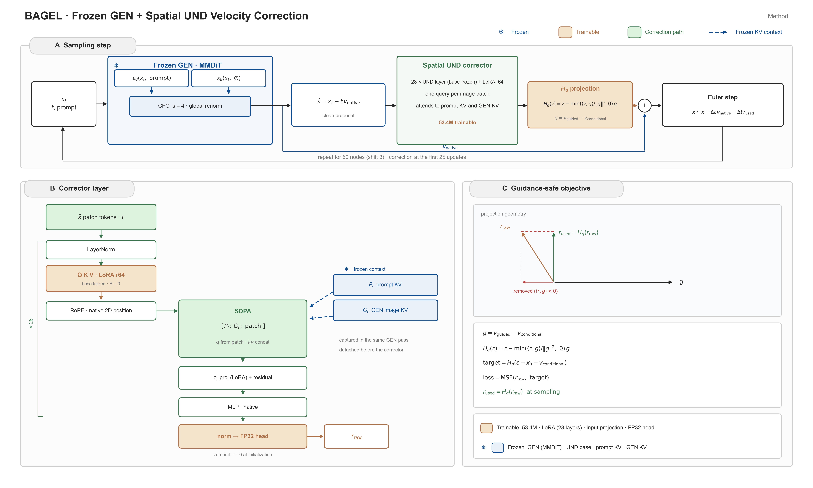

# 方法原理：冻结 GEN 上的空间 UND 速度纠错



## 1. 生成通路与 CFG

BAGEL 生成侧是 flow-matching 的 MMDiT。给定干净 latent `x0` 与噪声 `ε`，采样状态为

```text
x_t = (1 − t)·x0 + t·ε,     t: 1 → 0
```

网络在每个 `t` 预测条件速度 `v_conditional = GEN(x_t, t, prompt)`。部署时再做 CFG 与 renormalization：

```text
v_cfg    = v_reference + s·(v_conditional − v_reference)
v_native = v_cfg · clamp(‖v_conditional‖ / ‖v_cfg‖, renorm_min, 1)
```

`v_reference` 来自 CFG 的 reference 分支（空 prompt），`s` 为文本引导强度。`global` 模式按整条 latent 归一，`channel` 模式按最后一维归一。纠错在 CFG 之后接入，基准速度取 `v_native`。

## 2. 纠错器

纠错器由原生预训练 UND 的独立副本构成（28 层），每层在 `q/k/v/o` 上挂 rank-64 LoRA：

```text
LoRA(x) = W_base·x + B·A·x,    B 零初始化，A 随机初始化，W_base 冻结
```

### 2.1 前向结构

```text
proposal = x_t − t·v_native                      （detach 的干净图像估计）
h0       = W_in · vae2llm(proposal)
         + time_embedder(t)
         + latent_pos_embed(原生 2D 位置)
每层 l:
    q, k, v = LoRA(W_q, W_k, W_v)(LayerNorm(h))
    q, k    = RoPE(q, k)                          （原生位置与旋转实现）
    K_l     = [prompt KV ; GEN 同层 image KV ; k]
    V_l     = [prompt KV ; GEN 同层 image KV ; v]
    h       = h + W_o · SDPA(q, K_l, V_l)
    h       = h + MLP(LayerNorm(h))
r = W_head · LayerNorm(h)                         （FP32 输出，逐 patch）
```

- 一个图像 patch 对应一个纠错 query，携带原生 2D 位置与当前时间。
- prompt KV 与 GEN 同层 image KV 由 forward pre-hook 在同一次 GEN 前向中捕获，拼接后 detach，作为冻结上下文。
- 输入投影 `W_in` 从单位阵初始化，输出 `W_head` 从零初始化。初始化时刻 `r = 0`，采样轨迹与原生模型逐像素一致。
- 速度修正在 FP32 下读取，随后以一次增量加入 BF16 原生速度。

### 2.2 参数

| 组成 | 规模 |
|---|---|
| UND 28 层 LoRA | 主体 |
| 输入投影 | `hidden × hidden`，单位阵初始化 |
| 输出 head | `hidden × (latent_channel · patch²)`，零初始化 |
| 可训练参数合计 | 53,444,672 |

## 3. 目标函数

flow-matching 的回归目标是 `v* = ε − x0`。纠错器回归其残差形式：

```text
r* = ε − x0 − v_base
```

### 3.1 post-CFG 直接残差

取 `v_base = v_guided`：

```text
r* = ε − x0 − v_guided
   = (ε − x0 − v_conditional) − g,      g = v_guided − v_conditional
```

该目标包含 `−g` 分量。回归它会给沿 `−g` 方向的修正赋予正梯度，纠错器据此生成抵消 CFG 的速度分量。`g` 由 CFG 强度与 renorm 决定，在采样早期幅值更大。

### 3.2 guidance-safe 投影目标

把 `−g` 分量从目标中投影掉，只回归 guidance 正交部分：

```text
H_g(z) = z − min(⟨z, g⟩ / ‖g‖², 0)·g

target = H_g(ε − x0 − v_conditional)
loss   = MSE(r_raw, target)
```

`H_g` 的性质：

- **半空间投影**：`⟨z,g⟩ ≥ 0` 时 `H_g(z) = z`；`⟨z,g⟩ < 0` 时沿 `g` 减去反向分量。
- **幂等**：`H_g(H_g(z)) = H_g(z)`。
- **正交保持**：对任意 `w ⊥ g`，`⟨H_g(z), w⟩ = ⟨z, w⟩`。
- **恒等条件**：`g = 0` 时 `H_g` 为恒等映射。
- **线性**：`H_g(αz₁ + βz₂) = αH_g(z₁) + βH_g(z₂)`。

### 3.3 训练与部署的一致性

训练时投影作用在目标侧：loss 直接比较原始输出与 `H_g(ε−x0−v_conditional)`。原始输出因此保留完整梯度，沿 `−g` 的预测仍会被修正。

部署时投影作用在输出侧：

```text
r_used = H_g(r_raw)
```

两处使用同一个 `g` 与同一个算子。当 `r_raw` 收敛到 `target` 时，`H_g(r_raw) = H_g(target) = target`，训练最优解在部署阶段同样成立。全局常量场经过同一投影。

### 3.4 逐 patch 与逐样本

每个 patch 的修正独立投影，`g` 取对应 patch 的 guidance 速度。训练与推理共用该粒度。

## 4. 采样集成

时间节点由原生调度给出：

```text
u_i = linspace(1, 0, N),   N = 50
t_i = shift·u_i / (1 + (shift − 1)·u_i),   shift = 3
```

前 `ceil((N−1)/2) = 25` 次更新启用纠错，其余节点走原生速度。每次启用节点的 Euler 推进为

```text
x_{i+1} = x_i − (t_i − t_{i+1})·v_native,i
              − (t_i − t_{i+1})·r_used,i
```

第一项保持原生 BF16 乘积，第二项在 FP32 下累加一次。三条对照臂共用同一采样器与 seed：

| 臂 | 修正 |
|---|---|
| `native` | `r = 0` |
| `global` | `r = c(t_i)`（训练期估计的常量场） |
| `corrected` | `r = H_g(r_raw)` |

## 5. 全局常量场

对每个启用时间节点维护一个常量速度修正：

```text
c_i = mean over batch and ranks of target_i
```

实现上用 `sums` / `counts` 两个 buffer 累积，训练步结束时 all-reduce 合并。该常量场独立于纠错器的损失与优化器，用于给出时间相关的基线对照，并在验证中报告 `global` 臂的误差。

## 6. 训练配置

| 项 | 取值 |
|---|---|
| 数据 | 天然图文对（generation view，完整 caption），family 划分与 image-disjoint split |
| 全局 batch | 256 = 4 节点 × 16 NPU × micro-batch 1 × 累积 4 |
| 优化器 | AdamW，lr 1e-4，weight decay 0，clip 1.0，warmup 100 |
| 精度 | bfloat16 autocast；输入投影与输出 head 为 FP32 |
| 分辨率 | 512 |
| 采样 | 50 节点、shift 3、前 25 次更新启用纠错 |
| CFG | `s = 4`，`global` renorm，`renorm_min = 0` |
| 检查点 | 可训练参数、optimizer、sampler、provenance、每 rank RNG、常量场统计 |
| 冻结保护 | 每步校验冻结参数的梯度为空、版本号保持原值 |

续训恢复参数、优化器、数据采样器、每 rank RNG 与常量场统计；恢复条件为同一原生模型、同一语料 fingerprint、同一方法/优化配置、同一 world size。`steps`、`save_steps`、`val_images`、`activation_checkpointing` 属于可调字段。

## 7. 指标定义

| 字段 | 定义 |
|---|---|
| `loss` | 原始输出对当前配置目标的 MSE |
| `zero_correction_mse` | 零输出对同一目标的 MSE |
| `base_mse` / `applied_base_mse` | 原生 / 纠错后速度对 `ε − x0` 的物理 MSE |
| `residual_mse` | 验证时实际施加修正后的物理残差 |
| `delta_rms` | 实际施加修正的均方根 |
| `conditional_base_mse` / `conditional_corrected_mse` | 相对条件速度的物理误差 |
| `guidance_projection_raw` / `applied` | `⟨r, g⟩ / ‖g‖²`，投影前后 |
| `raw_negative_fraction` / `applied_negative_fraction` | 系数取负的比例；部署臂预期恒为 0 |
| `target_anti_removed_rms` | 目标中被投影删除的分量 |

报告规范：`loss` 与 `zero_correction_mse` 同组，度量目标拟合程度；`base_mse`、`applied_base_mse`、`residual_mse` 同组，度量物理速度误差。两组指标的度量对象相异，引用时按组标注。

## 8. 适用条件

- **单步定义**：训练目标定义在单步状态上；纠错改变的状态继续进入后续 GEN 前向，轨迹层的效果由实际图像检查承担。
- **投影前提**：`H_g` 把 guidance 方向视为部署中需要守恒的量；该前提由 CFG 的合成方式与 renorm 行为给出。
- **适配接口**：UND 通过冻结 KV 与 LoRA 适配 GEN，可训练容量由这两个接口决定。
- **调度参数**：50 节点、shift 3、512px、CFG 4 为本项目采用的配置；其它配置需要重新标定 `g` 与时间节点。
